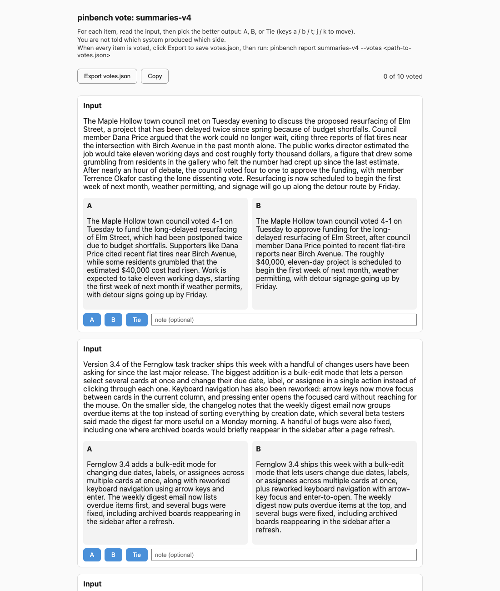

# pinbench

A model upgrade is a deploy. pinbench treats it like one. Every model you depend on is a
pinned id in a registry file, never a floating "latest" alias. When a vendor ships a newer
model in a slot you use, `pinbench watch` names it. `pinbench run` sends a frozen suite of
your own inputs through the incumbent and the candidate, refusing to start if the cost
estimate is over your cap and stopping if actual spend reaches it. `pinbench vote` builds a
blind A/B page where you judge outputs without knowing which model wrote which. `pinbench
report` unblinds the votes, scores against any reference labels, and prints a
RECOMMEND / HOLD verdict with the rule it applied stated in the output. `pinbench bump`
changes the pin only when a report for that exact pair says RECOMMEND, and commits the
change on a branch so the switch is a reviewable diff.

## The problem

Upgrading a model by feel works right up until a newer one is worse at your task and a
user tells you first. A vendor's release notes say "better in most benchmarks," which is
true and also not the question. The question is whether it is better at the one thing you
built on top of it, and the only way to answer that is to run it against your own inputs
before anyone else does.

I found this out running a small production pipeline. A newer flagship model, tried as the
judge in one step, agreed with 99 hand-labeled answers less often than the older model it
would have replaced: 83.8% against 88.9%. It also passed an answer that contained an
invented product detail, one the older model had caught. Nothing in the vendor's own
materials would have told me that. If that slot had pointed at a floating alias instead of
a pinned id, the regression would have shipped on the vendor's release day, not on a day I
chose.

The fix was not to stop upgrading, it was to make upgrading boring. The first real
candidate that went through this process, at roughly half the price of the incumbent, won
5, lost 4, and tied 4 of 13 frozen blind votes. I switched, because the downside of being
wrong was bounded: one reverted commit. The next candidate through the same process lost 4
to 6, with 3 ties, against the same incumbent and was kept out. Neither decision took more than reading
a printed report. See the full story: [the essay](https://www.ocarlsen.com/model-upgrades.html).

## Quickstart

```
pip install -e ".[dev]"
export ANTHROPIC_API_KEY=sk-ant-...
pinbench plan examples/suites/summaries.yaml --incumbent claude-sonnet-5-5 --candidate claude-haiku-5-5 --cap 0.25
pinbench run examples/suites/summaries.yaml --incumbent claude-sonnet-5-5 --candidate claude-haiku-5-5 --cap 0.25 --name demo
pinbench vote demo --open
pinbench report demo --votes ~/Downloads/votes.json
```

The summaries suite is 10 short passages; the live run below cost about two cents. To compare
across providers, also export `OPENAI_API_KEY` and pass an OpenAI model id (some OpenAI models
require a verified organization).

A third example, `examples/suites/review.yaml`, skips the blind vote page and scores with a
fixed judge model instead:

```
pinbench plan examples/suites/review.yaml --incumbent claude-sonnet-5-5 --candidate claude-haiku-5-5 --cap 1.50
pinbench run examples/suites/review.yaml --incumbent claude-sonnet-5-5 --candidate claude-haiku-5-5 --cap 1.50 --name review-demo
pinbench report review-demo
```

`plan` prints a third `judge` line alongside `incumbent`/`candidate`; the judge's own calls
count against the same `--cap`. The cap is higher here because the judge estimate assumes
every judge call spends its whole `judge.max_output_tokens` ceiling (4096 in this suite,
since the judge model always thinks and its thinking tokens count against that ceiling);
the actual spend is usually a fraction of that. See "Judge scoring" below.

## Sample report (live run)

A real run on 2026-10-26: should a summarization job move from `claude-sonnet-5-5` to the much
cheaper `claude-haiku-5-5`? Ten passages, both models, then ten blind votes by a human who did
not know which side was which.

```
# pinbench report: summaries-v4

**claude-sonnet-5-5** (incumbent) vs **claude-haiku-5-5** (candidate)

- Items: 10/10 completed
- Spend: $0.0209 of $0.25 cap (estimate $0.0412)

## Checks

| check | result | detail |
|---|---|---|
| completeness | PASS | n=10 >= 10 |
| errors | PASS | incumbent and candidate both had 0 errors |
| truncation | PASS | incumbent 0 truncated, candidate 0 truncated; allowed 0 per arm; PASS |
| votes_present | PASS | votes cover all 10 completed items |
| votes | PASS | candidate 1, incumbent 1, ties 8 of 10; PASS (non-losing) |
| cost | PASS | candidate $0.000093/item vs incumbent $0.002001/item (ratio 0.05, allowed 1.25); PASS |

## Verdict: RECOMMEND

a candidate is recommended when it is non-inferior on labels (within 0.0 points), non-losing on blind votes (ties excluded), and costs no more than 125% of the incumbent per item, over at least 10 completed items with no errors and no more than 0 truncated output(s) per arm. 10 items can show a large regression, not a small one (1/n = 10.0 points); the downside of a wrong RECOMMEND is bounded by `pinbench bump` being one reverted commit.
```

The votes were eight ties and one win each, and the candidate costs about a twentieth as much
per item, so the verdict is RECOMMEND. The rule says what that is worth: ten items can catch a
large regression, not a small one, and the switch is one reverted commit away.

The blind vote page from the same run (the instructions at the top are all a voter sees; model
ids never appear):



### What the first live runs caught

The tool was built and unit-tested offline first. The first three live runs each failed, and
each failure became a check that now ships with it:

1. **A rejected sampling parameter.** The newer model refused `temperature`, every call failed,
   and the first version still printed "10/10 completed" and built a vote page of blank cards.
   Now a failed call counts as a failure, a run where one side has zero successes exits nonzero,
   a request refused before generating is charged $0, and `vote` refuses to render missing output.
2. **Thinking that ate the budget.** The incumbent model reasons by default, so a tight output
   ceiling was spent on invisible reasoning: answers came back truncated, and one came back empty
   while still counted as a success. Now empty text is a failure, every output records its stop
   reason, and any truncated output makes the verdict INCOMPLETE.
3. **"Off" is spelled differently per model.** The two models accept different settings to turn
   reasoning off. That is a fact about each model, so it lives in the model registry
   (`request_defaults` in `prices.yaml`), not in a single hard-coded default.

None of these would have shown up as an error in a dashboard. They are the reason the verdict
can come back INCOMPLETE, and the reason a report states what it checked.

### A HOLD, for contrast

`examples/suites/capitals.yaml` has labeled answers instead of votes. In an offline demo with two
candidate answers scripted wrong (Sydney for Australia, Istanbul for Turkey), the labels check
fails at 83.3% against 100%, and the verdict is HOLD even though the candidate is twenty times
cheaper: a cheaper model that is wrong more often is a regression, and `bump` refuses the pair.

## Judge scoring

Exact/contains/regex matching needs a reference answer, and a blind vote needs a human to sit
down and vote. Neither fits an open-ended task like "review this diff for defects," where the
right answer is "did it find the planted problems," not one fixed string. A suite can declare
`scoring.labels: judge` instead: a fixed `judge` model and a free-text `rubric` at the suite
level, plus a per-item list of `rubric_points` (each an `id` and a `description` of one thing
a correct response should catch) and an optional list of `decoys` (plausible-looking issues
that are not the planted one, documentation only, never sent to the judge as if they mattered).

Why a fixed judge, out loud, every run: an LLM judge is itself a model with its own failure
modes, so letting it float between runs would hide a regression in the judge inside what looks
like a regression in the candidate. `judge.model` is one pinned id, the same discipline this
tool applies to `incumbent`/`candidate`, and `judge.assert_comparable` refuses to treat two
reports as the same measurement when the judge id or the rubric (hashed into
`judge_prompt_hash`) differs between them.

Why blind: the judge call for one arm's output never sees the other arm's output, never sees a
model id, and never sees the words "incumbent" or "candidate" -- it sees the rubric, the
rubric point ids and descriptions, the item input, and exactly one response, presented
identically regardless of which arm produced it. Which arm is graded first is still
randomized per item with `secrets.SystemRandom` and recorded (`call_order` in `run.json`), the
same discipline the vote page's A/B mapping uses, even though a single-output judge call has
less to leak than a side-by-side vote.

The judge must answer in strict JSON, `{"hit": [ids], "extra": int, "notes": str}`: which
rubric point ids it found satisfied, a count of other real findings beyond the rubric, and a
one-line note. A reply that is not valid JSON, or whose `hit` names an id the item never
declared, is a judge error for that item, counted and never guessed at -- same bucket as an
arm that returned an HTTP error. Per arm, across the run: **recall** is hits over total rubric
points, and **extra** is the mean "extra" count (a precision proxy: a model that hits every
point by flagging everything in sight is not actually better). The judge's own calls are
estimated and metered against the same `--cap` as the arms (`pinbench plan` prints a third
`judge` line), and refuse to self-judge: a suite whose judge id equals either arm's id is
refused unless you pass `--allow-self-judge`.

The verdict adds `judge_errors` (INCOMPLETE if nonzero, same as an arm error), `judge_recall`
(HOLD unless the candidate is within `policy.recall_tolerance_points`, default 0.0, of the
incumbent), and `judge_extra` (HOLD unless the candidate's mean extra-findings count is no
more than `policy.extra_tolerance`, default 0.5 per item, worse than the incumbent's).

For the cost check, a judge strict win (candidate recall strictly better than the incumbent
beyond `recall_tolerance_points`, with `judge_extra` also passing) waives the cost tolerance
on its own only when `scoring.votes` is `none` -- that is the only signal a suite with no
vote collection has. A judge suite that also collects votes has two independent signals, and
both must agree: the judge strict win AND a candidate strict win on the vote tally, the same
pairing a labeled suite uses (label strict win plus vote strict win). It is one instrument
standing in for two, so treat a RECOMMEND that rests on it as "worth the money" by the
judge's lights, not by yours.

Two practical limits. The judge's `max_output_tokens` is a ceiling on its whole reply, and on
a judge model that always thinks (Claude Opus 5.5, for one: `thinking` cannot be turned off,
and its thinking tokens are billed as output and count against `max_tokens`) a tight ceiling
produces a cut-off or empty reply, which is a judge error, which makes the run INCOMPLETE.
Leave room. And the judge sees the arm's raw output: pinbench strips nothing from it, so a
model that names itself in its answer ("As Claude, ...") unblinds that one call. The example
suites' tasks do not invite that, but a suite whose task does should expect it.

Limits, stated plainly: a judge is a model, not a ground truth, and it can agree with itself
more readily than it agrees with a careful human -- calibrate it against a small set of human
labels before trusting it for a real bump decision, the same way you would not trust a label
check you had never spot-checked. This tool does not build that calibration step for you; see
[the essay](https://www.ocarlsen.com/model-upgrades.html) for the longer argument on checking any judge, human or model, against ground
truth before it gets to decide anything.

## Design decisions

**Pins, not aliases.** A floating alias changes what you are running on a date the vendor
picked, not a date you picked. A pin changes only when `bump` changes it, and `bump`
changes it only on a RECOMMEND.

**Your own frozen inputs, not a leaderboard.** A public benchmark score tells you how a
model does on someone else's task. The only score that matters for a bump decision is how
it does on yours, so the suite is your own inputs, frozen by a hash, run every time
unchanged.

**Blind, and the key lives outside the page.** A judgment made while you know which output
is the familiar one is not a judgment, it is a habit. The vote page never shows a model id,
and the mapping that would unblind it lives in a separate file the page never reads.

**The cost cap is checked before and during.** A pre-run estimate can still be wrong, for
instance when a model's real output runs longer than its stated ceiling. The meter checks
again before every single call, so a cap is a hard stop, not a hope.

**The decision rule is printed, not implied.** A RECOMMEND or HOLD with no stated rule is
an opinion. Every report prints the exact rule it applied, with every number read from the
suite's policy, so the next person can check the math instead of trusting the verdict.

**A bump is a commit on a branch.** Changing a pin is a code change with a clear before and
after, which means it is also a code change you can revert with one command if it turns
out to be wrong.

**A watch that calls no model.** Checking whether a vendor shipped something newer should
never itself cost money or risk a call to an untested id. `watch` only lists models and
diffs id strings.

**The judge is one fixed model, named out loud.** A report that used a different judge
model, or the same judge model with a different rubric, every time it ran would be
measuring something new each time while looking like the same measurement. `run.json` and
the report header record the judge's model id and a hash of its rubric, and comparing two
runs across that boundary is a refusal (`judge.assert_comparable`), not a silent diff.

**Both live runs so far caught silent failures the hermetic tests had not.** The first live
run sent every call with no sampling defaults, hit an HTTP error on both arms, and the CLI
used to still print "items completed: 10/10", exit 0, charge the run estimate, and let
`vote` build a page with blank A/B cards; that shape is now `test_live_run_failure_regression.py`.
The second live run surfaced a quieter failure: 19 of 20 outputs hit `max_output_tokens`
mid-sentence with no flag raised, and one came back an empty string -- still counted as
succeeded -- because a current Claude model's default extended thinking spent the entire
60-token ceiling before writing any visible text. Neither failure threw an exception or
returned a non-2xx response; both looked, from the caller's side, like success. `run.json`
now always records each arm's `stop_reason`, an empty extracted text is a recorded failure
never a success, and `report`/`vote` both refuse to treat a truncated output as a complete
one without saying so.

## Commands

| command | what it does |
|---|---|
| `pinbench pins` | print the registry as a table |
| `pinbench plan SUITE --incumbent ID --candidate ID [--cap USD] [--allow-self-judge]` | estimate cost, no spend |
| `pinbench run SUITE --incumbent ID --candidate ID [--cap USD] [--allow-self-judge]` | run both arms (and the judge, if any), write run.json |
| `pinbench vote RUN_NAME [--open] [--allow-missing] [--allow-truncated]` | build the blind A/B page |
| `pinbench report RUN_NAME [--votes votes.json]` | unblind, score, print the verdict |
| `pinbench watch [--seed]` | diff each provider's catalog against the last snapshot |
| `pinbench bump SLOT --to ID --run RUN_NAME` | edit a pin, gated on a RECOMMEND report |
| `pinbench config [--suite SUITE]` | print the effective settings and where each one came from |

Every command above also takes `--config PATH` (see "Configuration"); `plan`/`run` take
`--prices`, `pins`/`watch`/`bump` take `--pins`, and every command that reads or writes
run state takes `--state`, each resolved the same way.
`--cap` on `plan`/`run` is no longer always required at the command line -- it still has to
come from *somewhere* (see "Configuration"), but that can be the suite or `pinbench.yaml`.

Every command has `--help`. Exit codes: 0 ok, 1 error (including `vote` refusing a run with
missing output), 2 refusal before any spend, 3 the cost cap was exceeded, 4 a `run` where
one arm got zero successes. `run` prints a per-arm `succeeded/attempted` line and the first
error (truncated) when an arm had any; it still exits 0 with a warning when some, but not
all, items completed on both arms -- only a wholly-failed arm is exit 4.

`vote` refuses (exit 1) when any item is missing output on either arm, naming the item/arm
pairs, rather than rendering a blank card; `--allow-missing` renders those as explicit
error cards instead. `vote` also refuses when any item's output was truncated by the
output ceiling, naming the item/arm pairs; `--allow-truncated` renders those cards with a
visible "truncated" badge instead of silently showing a cut-off answer as if it were
complete. `report` folds any per-arm error above zero, or more than `policy.max_truncated`
(default 0) truncated outputs on either arm, into an INCOMPLETE verdict (see Design
decisions), and a 4xx error that happened before the model generated anything costs $0 in
`run.json`, never the pre-run estimate.

`run` always records each arm's own stop/finish reason (`stop_reason` in `run.json`,
Anthropic's `stop_reason` or OpenAI's `finish_reason` verbatim) and prints a per-arm
truncated count plus a loud warning when any output hit the ceiling -- that warning is not
itself a refusal (`run` still exits 0), because whether a few truncated items sink the
verdict is `report`'s call, gated by `policy.max_truncated`.

## Configuration

An optional `pinbench.yaml` at your project root sets project-wide defaults, so you don't
repeat `--prices`/`--state`/`--cap` on every call or paste the same `policy:` block into
every suite. pinbench finds it by walking up from the current directory (or pass
`--config PATH` to point at one directly); having no `pinbench.yaml` anywhere is fine --
every setting then falls back to pinbench's own built-in defaults.

```yaml
# pinbench.yaml
cap_usd: 0.50
judge:
  model: claude-opus-5-5
  max_output_tokens: 1024
  # rubric has no sensible generic default; a judge suite must still state its own, or
  # loading refuses, exactly as if no pinbench.yaml existed.
paths:
  pins: examples/pins.yaml
  prices: examples/prices.yaml
  suites: examples/suites
  runs: .pinbench
policy:
  min_items: 10
  label_tolerance_points: 0.0
  cost_tolerance: 0.25
  require_votes_when_unlabeled: true
  max_truncated: 0
  recall_tolerance_points: 0.0
  extra_tolerance: 0.5
```

`incumbent`/`candidate` are deliberately NOT a config key: which two models are being
compared is a choice made deliberately, per run, never defaulted by a file. An unknown
top-level or nested key, a value of the wrong type, or an out-of-range value (a cap at or
below zero, a negative tolerance, `min_items` under 1) refuses with the key and value
named -- never a silent fallback to the built-in default.

Every setting pinbench.yaml can set follows the same precedence, applied the same way
everywhere it is used:

| precedence | example |
|---|---|
| 1. CLI flag | `--cap 0.75` |
| 2. the suite's own value | a suite's top-level `cap_usd:`, or its `judge:`/`policy:` block |
| 3. `pinbench.yaml` | this file's `cap_usd`, `judge`, `paths`, `policy` |
| 4. built-in default | `cap_usd: null` (a cap must come from somewhere), `judge.model: claude-opus-5-5`, `.pinbench` for `paths.runs`, etc. |

A `paths` value from `pinbench.yaml` is resolved relative to *that file's own directory*,
so the same `pinbench.yaml` behaves the same regardless of which directory you run
`pinbench` from; a `--prices`/`--state`/`--pins` flag or a built-in default path is left
exactly as given (relative to your current directory, same as before this feature existed).
Wherever a config-resolved path or the config file's own location is printed or persisted
(`pinbench config`, `run.json`, the report header), it is written relative to your current
directory, so a `report.md` that `bump` commits never carries an absolute path from one
machine.

`pinbench config [--suite SUITE]` prints every effective setting and which tier it came
from -- pass `--suite` to also see how that suite's own `cap_usd`/`judge`/`policy` fold in:

```
$ pinbench config --suite examples/suites/review.yaml
config file: pinbench.yaml
config hash: sha256:...
cap_usd: 0.5  (source: config)
judge:
  max_output_tokens: 4096  (source: suite)
  model: 'claude-opus-5-5'  (source: suite)
  rubric: '...'  (source: suite)
paths:
  pins: examples/pins.yaml  (source: config)
  ...
policy:
  ...
```

Every `run` records its own FULL effective settings -- cap, judge/policy fallbacks, paths,
and which config file (if any) with its content hash -- in `run.json`, with the source of
each value. `pinbench report` reuses that exact recorded fallback to reload the suite, so a
report built later reproduces the run correctly even if `pinbench.yaml` has since changed
or been deleted; the report header names the config file and its hash whenever the run
used one.

## Suite format

A suite is a frozen set of inputs in `suite.yaml` (or `.json` with the same keys): a
`task` string used as the system prompt for both arms, a `max_output_tokens` ceiling, an
optional `params` dict of extra sampling params sent to both arms verbatim (empty by
default; set `params: {temperature: 0}` only if you want it and your models accept it), a
`scoring` block (`labels: exact | contains | regex | none | judge`, a `normalize` list, and
whether `votes` are `required | optional | none`), a `policy` block with the decision
rule's knobs (including `max_truncated`, the number of truncated outputs tolerated per arm
before the verdict refuses to call the run complete -- default 0, and, for judge suites,
`recall_tolerance_points` and `extra_tolerance`, see "Judge scoring"), and a list of `items`,
each with an `id`, an `input`, and an optional `expect`. Either every item has `expect` or
none do, unless `scoring.labels` is `judge`, in which case `expect` is not used and every
item instead needs a non-empty `rubric_points` list (`id` + `description`) and a suite-level
`judge` block (`model`, `rubric`, optional `max_output_tokens`).

Three example suites ship in `examples/suites/`: `capitals.yaml` (12 labeled items, world
capitals, exact match), `summaries.yaml` (10 unlabeled items, each a short synthetic
paragraph, vote-only), and `review.yaml` (6 synthetic code/config snippets, each with one
planted defect and a decoy, scored by a fixed judge model).

## Limits

- Two providers: Anthropic and OpenAI. Adding a third is one file in `providers/`.
- Label matching is exact, contains, or regex, or a fixed LLM judge scoring recall against a
  rubric (see "Judge scoring"); there is no fourth mode, and a judge suite does not also
  support `expect`-based labels on the same items.
- n is whatever you froze. The report states what that n can and cannot detect; a 12-item
  suite cannot show a regression smaller than roughly 8 percentage points.
- Prices are a file you maintain, not a live lookup. An unpriced model refuses to run
  rather than guess.
- The watch comparator is a heuristic over id strings (family and version tokens), not a
  vendor feed. It will miss a rename that does not follow the pattern.
- Both arms get the same `task` as the system prompt and the same `max_output_tokens`
  ceiling, but each arm's request can differ beyond that: a model's own `request_defaults`
  row in `prices.yaml` (e.g. how it turns extended thinking off) is sent first, then the
  suite's own optional `params` (e.g. `params: {temperature: 0}`) are applied on top and
  win on any key both set -- pinbench never injects a sampling default of its own, only
  what a model's registry row or the suite itself asked for. Newer models increasingly
  reject a fixed temperature outright, and determinism was never guaranteed by setting it
  anyway, so the suite opts in only when it wants to. Whatever was actually sent is
  recorded in `run.json` under `request_params`, per arm. A candidate that rejects a param
  the suite (or its own registry row) set records that rejection as an error, which makes
  the verdict INCOMPLETE, not a silent retry.
- No confidence intervals, inter-rater agreement, or rotating reviewers; no hosted voting;
  no chat or email notifications, scheduler, or daemon (`watch` is a one-shot you cron); no
  automatic PR creation or rollback tooling; no reasoning-effort normalization across
  models.
- Current Claude models run extended thinking by default, and a thinking block's tokens
  count against `max_output_tokens` -- on a suite with a low ceiling this could spend the
  entire budget on an invisible thinking block and return an empty text output as a
  "success" (see the fail-loud empty-output check above). How a given Claude model turns
  thinking off is not one syntax across model generations (one generation accepted
  `thinking: {"type": "disabled"}`; the next 400s on that exact value and wants
  `{"type": "between_tools"}` instead, observed 2026-10-26), so the adapter itself carries
  no such default -- it is a per-model `request_defaults` row in `prices.yaml`, merged
  under the suite's own `params` (see the request_params bullet above). A model with no
  row-level opinion gets no such key at all.

## Development

```
pytest -q
```

Runs entirely offline; `PINBENCH_NO_NETWORK=1` is set by `conftest.py`, and
`test_no_network.py` proves the full CLI pipeline never opens a socket.

To add a provider: create `pinbench/providers/<name>.py` with a `call(...)` and a
`list_models(...)` function matching the shape in `providers/anthropic.py`, then register
it in `providers/__init__.py`: one entry each in `ADAPTERS` and `ENV_KEYS`, and one prefix
line in `provider_for_id`. The adapters use plain `urllib` so the stubbing seam is obvious
and the dependency list stays at one line; the official SDKs are a drop-in swap behind
`providers/`.

## License

MIT. See `LICENSE`.
